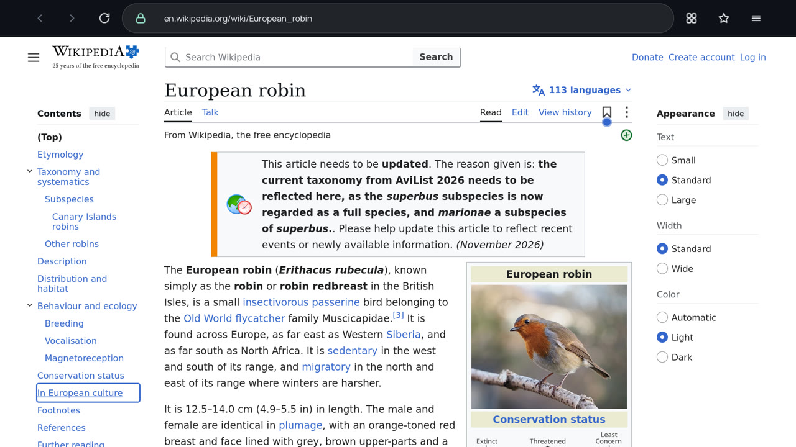
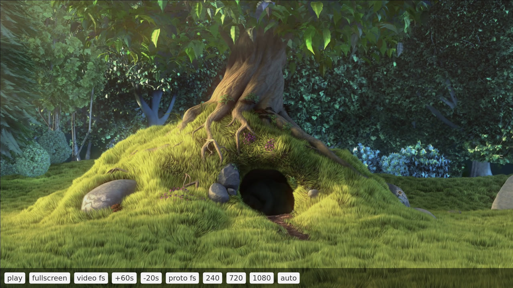

<p align="center">
  
</p>

<h1 align="center">Robin</h1>

<p align="center">
  A web browser for rooted LG webOS TVs, built to be driven with the remote.<br>
  Based on <a href="https://github.com/sostk/webos-wpe-browser">Wren</a> by sostk.
</p>

<p align="center">
  <a href="https://github.com/mihai2mn/robin-webos/releases/latest"></a>
  
  
  <a href="LICENSE"></a>
</p>

<p align="center">
  <a href="#install">Install</a> ·
  <a href="#what-it-does">What it does</a> ·
  <a href="#limits">Limits</a> ·
  <a href="#based-on-wren">Credits</a> ·
  <a href="docs/README.md">Documentation</a>
</p>


## Why this exists

The browser that ships on an LG CX is old, and most modern sites either break in it or crawl. Wren put a current
WebKit on the TV. Robin continues from Wren 0.3.3 with a newer engine, an ad blocker, a reworked video path and a
memory budget that fits the TV. On the CX it was built on, that is the difference between a browser you avoid and
one you use: pages load, video plays through to the end, and the remote is enough to get around.

Robin 1.0.0 is the first release. It was tested on one TV, an LG CX on webOS 5.3. Read the [limits](#limits) before
you install.

## What it does

<table>
  <tr>
    <td width="50%"></td>
    <td width="50%"></td>
  </tr>
  <tr>
    <td valign="top"><b>Browsing.</b> Arrows move a pointer and scroll, OK clicks, Back goes back. Press ▲ at the top of a page for tabs and the address bar.</td>
    <td valign="top"><b>Side panel.</b> Bookmarks, history, zoom per site and settings, one key away.</td>
  </tr>
  <tr>
    <td></td>
    <td></td>
  </tr>
  <tr>
    <td valign="top"><b>Ad blocker.</b> uBlock Origin's filter lists, switchable one by one, plus a box for your own rules.</td>
    <td valign="top"><b>Video.</b> Hardware decoding through the TV's own pipeline, full screen, with the remote's media keys.</td>
  </tr>
</table>

- **YouTube works properly.** Videos play on the hardware decoder at full quality, with full screen, seeking and
  the remote's media keys. On the TV's built-in browser it does not.
- **A current engine.** WPE WebKit 2.54.3. WebKit 2.54 switched the JavaScript JIT off on all 32-bit builds; Robin's
  patches bring the ARMv7 Baseline JIT and DFG back ([how](docs/jit-armv7.md)).
- **An ad blocker** built on Brave's adblock-rust: network rules, redirects, scriptlets, cosmetic and procedural
  filters, pop-up rules ([details](docs/ad-blocking.md)).
- **Hardware video** for H.264 and VP9 with AAC or PCM audio, seeking, page volume and mute, and play, pause, stop,
  rewind and fast-forward from the remote ([details](docs/video.md)).
- **Memory limits that hold.** The web process is capped, the back/forward page cache is off, and at most two small
  videos are decoded in software at once.
- **Zoom remembered per site**, bookmarks, history and tabs that come back after a restart ([usage](docs/usage.md)).

### Measured on the CX

All figures are from one LG CX on webOS 5.3, November 2026.

| Test | Result |
|---|---|
| A 10-minute streaming video on a real site, default settings | Played to the end. Web process peak 511 MB, limit 832 MB |
| Video starts on a static page | 0 black pictures in 40 starts (9 in 62 before the fix) |
| A news page with four autoplaying background videos | About 360 MB with the software-video limit, about 700 MB without |
| Ad blocker cost on four news and reference sites | Load time between +1.6 s and −0.4 s, about +40 MB of memory |

## Install

You need a TV with root access and the [Homebrew Channel](https://www.webosbrew.org/).

1. Download `io.github.mihai2mn.robin_1.0.0_arm.ipk` from the
   [latest release](https://github.com/mihai2mn/robin-webos/releases/latest) and check it against `MD5SUMS`.
2. Install it from the Homebrew Channel, or from a PC:

```sh
ares-install -d <your-device> io.github.mihai2mn.robin_1.0.0_arm.ipk
```

The package is about 105 MB to download and 230 MB installed. Have about 400 MB free on the TV's app storage before
you start: an install that runs out of space leaves an app that will not open.

Robin has its own app id, so it installs beside Wren and does not replace it. To bring your Wren bookmarks, history
and filters across, see [Keeping your Wren data](docs/release-notes-1.0.0.md#keeping-your-wren-data).

The release also has `io.github.mihai2mn.robin.dev_1.0.0_arm.ipk`, a second copy that shows as "Robin Test" and keeps
its own data. Most people do not need it.

## Limits

- **One TV model tested.** Other models and webOS versions may work or may not. Reports are welcome.
- **One hardware video at a time.** The TV has one decoder per app. A second video waits until it is the one playing.
- **A paused video that goes full screen stays black until you press play.**
- **Protected (DRM) video was not tested.** Widevine runs at software security level, so services may cap quality
  or refuse. Robin, like Wren, uses the CDM already on the TV, outside the terms it ships under. Use at your own risk.
- **Small muted videos above 720p are not played** until you start them yourself. This keeps pages with many
  background videos inside the memory limit.
- **The RegExp JIT is off** on the 32-bit engine. It crashed one tested site.
- **Cloudflare checks take about a minute** on the TV's processor. Wait for them.

<details>
<summary>More known issues</summary>

- An unmuted video goes to the hardware plane so its sound is heard. That plane does not scroll exactly with the page.
- Full screen for hardware video is emulated: the element is stretched over the screen. An overlay with a very high
  z-index can still cover it ([details](docs/video.md#fullscreen)).
- A video scrolled partly off screen is cropped by the compositor on the tested CX. On older webOS it is shrunk into
  the visible part instead.
- Audio was verified in the player logs, not by a listening test.
- An experimental 64-bit engine exists in the source but is not in the release packages: it draws in software and
  has no hardware video ([details](docs/engine64.md)).
- Video test pages need a server that supports HTTP range requests. `python -m http.server` does not.

</details>

## Reporting a bug

Plug a USB drive into the TV. In Robin, hold OK, then **Settings**, **Help and feedback**, **Save logs to USB**.
Attach the `robin-logs-….txt` file to a report in the [issue tracker](https://github.com/mihai2mn/robin-webos/issues).
Logs are cleared when the TV restarts, so save them first.

Please report Robin's bugs here and not to Wren. Upstream has not seen this code.

## Based on Wren

Robin is a fork of **[Wren](https://github.com/sostk/webos-wpe-browser)** by **sostk**, taken at version 0.3.3.
The browser itself, its remote-first interface, the split between the UI and the engine, the Buildroot-based WebKit
build, the Widevine bridge and most of the media design are upstream's work. Robin keeps Wren's licence and its full
commit history. Without Wren there would be no Robin.

Robin is independent. Upstream has not reviewed, endorsed or tested it, and it is not a Wren release. For the
original project, its releases and its list of supported TVs, go to
[upstream](https://github.com/sostk/webos-wpe-browser). The About screen in Robin says "Based on Wren 0.3.3 by sostk".

Some internal names still say Wren (the `wren://` page addresses, file names). They were kept so that nothing breaks.

Robin also stands on:

| Project | Used for | Licence |
|---|---|---|
| [WPE WebKit](https://wpewebkit.org/) | The browser engine | LGPL-2.1 and BSD |
| [webOS native app kit](https://github.com/Native-Webos/webos-native-app-kit) | The app shell and packaging | see the kit |
| [adblock-rust](https://github.com/brave/adblock-rust) by Brave | The ad blocker's matching engine | MPL-2.0 |
| [uBlock Origin](https://github.com/gorhill/uBlock) | Filter lists, redirects and scriptlets | GPL-3.0 |
| EasyList, EasyPrivacy, AdGuard and other list authors | Filter lists | each list's own terms |
| [Big Buck Bunny](https://peach.blender.org/), © Blender Foundation | The video frame in the screenshot above | CC BY 3.0 |

Every bundled component, with its source and licence, is listed in [NOTICE.md](NOTICE.md). The icon was generated
with an AI image tool at the maintainer's request and traced to vector; it uses no third-party artwork.

## Documentation

- [Using Robin](docs/usage.md): the remote, launch parameters, logs
- [How it works](docs/architecture.md) and [video](docs/video.md)
- [Building](docs/building.md) and the [patch series](docs/patches.md)
- [Release notes for 1.0.0](docs/release-notes-1.0.0.md)
- [Changelog](CHANGELOG.md): what changed since the last release
- [Everything else](docs/README.md)

## Contributing

Reports from other TV models help most: use the **Works on my TV** form in the [issue tracker](https://github.com/mihai2mn/robin-webos/issues/new/choose).
For code, see [CONTRIBUTING.md](CONTRIBUTING.md). Security problems: [SECURITY.md](SECURITY.md).

## Licence

GPL-3.0-or-later, see [LICENSE](LICENSE). Third-party code, fonts, icons and filter lists keep their own licences,
see [NOTICE.md](NOTICE.md). Widevine is not included.
