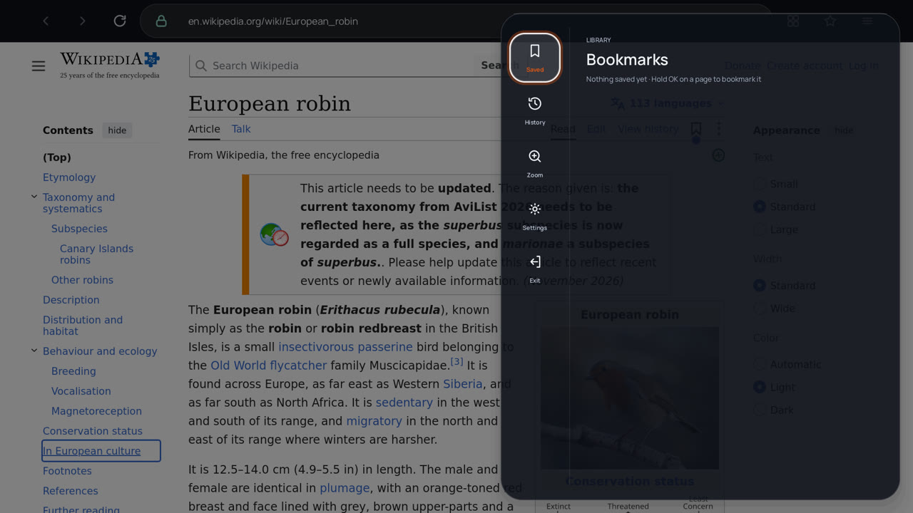

<p align="center"></p>

# Wren (fork): a web browser for the LG CX

A WPE WebKit browser for rooted LG webOS TVs, run from the arrows, OK and Back of the remote. This fork is built on
**[Wren by sostk](https://github.com/sostk/webos-wpe-browser)** (upstream 0.3.3) and goes its own way: a newer engine,
an ad blocker, a different video path and a tighter memory budget, all developed and tested on one LG CX.

| | |
|---|---|
|  **Home**: search, shortcuts, recent pages, open tabs |  **Browsing**: ▲ at the top of a page shows the tabs and the toolbar |
|  **Hold OK**: quick actions and page zoom |  **Menu**: bookmarks, history, zoom, settings |

The screenshots are upstream's and may differ in small ways from this fork's interface.

## What you get on a CX today

Measured on an LG CX (webOS 5.3) with this fork's development package, 2026-11-22:

- **A full-length streaming video played to its end on default settings.** The web process peaked at 683 MB against
  an 832 MB limit. The fork's memory limits and its default of no back/forward page cache are what make this fit.
- **No black picture on static pages.** Black-picture starts happened in 9 of 62 launches before the fix and in 0 of
  30 with it.
- **An ad blocker that costs little.** On four news and reference sites, page load time changed by between +1.6 s and
  -0.4 s, and memory rose by about 40 MB typically ([docs/ad-blocking.md](docs/ad-blocking.md)).
- **A newer engine with the JIT back.** WPE WebKit 2.54.3 instead of 2.50.5. WebKit 2.54 turned the JIT off on all
  32-bit builds; this fork's patch series brings the ARMv7 Baseline JIT and DFG back on the TV's 32-bit userland
  ([docs/jit-armv7.md](docs/jit-armv7.md)). The RegExp JIT stays off.
- **Hardware video through LG's Starfish pipeline**, with page volume and mute, seeking, and the remote's play, pause,
  stop, rewind and fast-forward keys acting on the page's main video ([docs/video.md](docs/video.md)).
- **Zoom remembered per site** ([docs/usage.md](docs/usage.md)).

The one-line summary of everything below: browsing on the CX works for ordinary sites, and the limits are listed
under [Limitations](#limitations-and-known-issues). They are not small. Read them before you install.

## Credit and independence

The browser, its remote-first interface, the Widevine bridge, the Buildroot-based WebKit build, the split between UI
and engine, and most of the media design are the work of **sostk** and the upstream contributors. Without Wren this
fork would not exist, and it keeps upstream's licence and history. Please look at
[upstream](https://github.com/sostk/webos-wpe-browser) for the original project, its releases and its supported
devices.

This fork is independent. Upstream has not reviewed, endorsed or tested it. Bugs in this fork belong in this
fork's issue tracker, not upstream's. Where this fork says "upstream" it means Wren 0.3.3.

Also used and not ours: [WPE WebKit](https://wpewebkit.org/), the
[webOS native app kit](https://github.com/Native-Webos/webos-native-app-kit),
[adblock-rust](https://github.com/brave/adblock-rust) from Brave, and the filter lists and scriptlets of
[uBlock Origin](https://github.com/gorhill/uBlock), EasyList and others. The full list with licences is in
[NOTICE.md](NOTICE.md).

## What this fork adds over upstream 0.3.3

- **WPE WebKit 2.54.3** with a patch series ([patches.md](docs/patches.md)) and the ARMv7 JIT work above.
- **A uBlock Origin style ad blocker** (`engine/ubo`) on adblock-rust: network rules, redirects, scriptlets, generic
  and site cosmetic filters, procedural filters, pop-up rules, and a **My filters** box on `wren://adblock`
  ([ad-blocking.md](docs/ad-blocking.md)).
- **An optional 64-bit (aarch64) engine** in the same package. It runs the 64-bit JIT but draws in software and has no
  hardware video ([engine64.md](docs/engine64.md)).
- **Hardware video through Starfish**: H.264 and VP9, AAC audio, other decoded audio (Opus, Vorbis) sent as PCM, page
  volume and mute, seeking, and a hybrid policy that keeps small muted previews in the page and puts the rest on the
  hardware plane ([video.md](docs/video.md)).
- **Remote media keys** and **page zoom per site** ([usage.md](docs/usage.md)).
- **Memory limits** for the web and network processes, no back/forward page cache by default, and a declared memory
  need in the app's `appinfo.json`.
- **Clean-clone release packaging** (not bit-for-bit reproducible: the toolchain image, the filter lists and the
  staged base are not pinned): `tools/package-release.sh` builds the ipk from a clean clone of a commit
  ([building.md](docs/building.md)).

The full list, grouped, is in [docs/release-notes-0.3.3-cx1.md](docs/release-notes-0.3.3-cx1.md).

## Tested hardware

Everything in this fork was tested on one TV: an **LG CX with webOS 5.3** (kernel 4.4.84, about 2.7 GB of RAM).
Other models and webOS versions are untested by this fork. The upstream compatibility notes are in
[compatibility.md](docs/compatibility.md). They describe upstream's testing, not this fork's.

## Install

You need a TV with root access (the Homebrew Channel). The ipk is large: **about 230 MB to download and about 546 MB
installed**, because it carries two engines. The installer needs roughly 380 MB free on the TV's app storage
(see [building.md](docs/building.md#size)). Free space first.

1. Download the ipk from this fork's releases page (TODO(owner): add the link). The files are named
   `org.sostk.wpebrowser_0.3.3_arm.ipk` (the real id) and `org.sostk.wpebrowser.dev_0.3.3_arm.ipk` (a test id that
   installs beside the real app). Check them against `MD5SUMS` from the same page.
2. Install it with the Homebrew Channel's local install or:

```sh
ares-install -d <your-device> org.sostk.wpebrowser_0.3.3_arm.ipk
```

The real id replaces an installed upstream Wren. Remove or keep upstream's copy as you prefer. Use the dev id to try
the fork next to it. To go back to upstream, remove this fork and install upstream's release
(see the [release notes](docs/release-notes-0.3.3-cx1.md#going-back-to-upstream)).

Installing from the Homebrew Channel repository is upstream's route and installs upstream's build, not this fork.

## Using it

The remote, launch parameters and logs are in [usage.md](docs/usage.md). The 32-bit engine is the default. To try the
64-bit engine, launch once with `{"wpebEnv":{"WPE_BROWSER_DEBUG_ENGINE":"64"}}`, or put a file named `engine64`
containing `on` in the app's data folder ([engine64.md](docs/engine64.md)).

## Test tools

`tools/tvdrive/` drives the dev copy of the app from a PC (screenshots, pointer, remote keys, on-screen keyboard), and
reads back what the screen and the page did as text (`frames`: static, moving, flicker; `motion.js`: element motion
from a recorder script). It needs a rooted TV. See [usage.md](docs/usage.md) and [tools/tvdrive/README.md](tools/tvdrive/README.md).

## Reporting a bug

Plug a USB drive into the TV, then in the browser: hold OK, **Settings**, **Help and feedback**, **Save logs to USB**.
Attach the `wren-logs-….txt` file to a bug report in this repository's issue tracker (the Issues tab). Logs are cleared when
the TV restarts, so save them first.

The in-app "Report a problem" row still shows upstream's issue address. Do not use it for this fork.

## Limitations and known issues

- **One TV model tested.** Everything above comes from one LG CX on webOS 5.3.
- **Audio is not confirmed by ear.** Video with AAC or PCM audio was checked in the engine and player logs (the
  volume, mute and PCM calls reach LG's pipeline). Nobody has yet listened to it on the TV.
- **The RegExp JIT is off on the 32-bit engine.** With it on, the web process of one tested site crashed shortly
  after load. The Baseline JIT and DFG are on. A page load was not faster with the JIT in the tests. See
  [jit-armv7.md](docs/jit-armv7.md).
- **The 64-bit engine is software rendered**, sends shared-memory frames only, and has no hardware video. Cold page
  loads are slower than on the 32-bit engine (Wikipedia: 8.2 s against 4.7 s in the same mode).
- **Only one hardware video at a time** (LG's pipeline).
- **The package is large.** The ICU data and some libraries are present twice, once per engine.
- **Hybrid video trade-off.** An unmuted video goes to the hardware plane so that its sound is heard. That plane does
  not scroll exactly with the page, and a short clip with sound inside an article also moves there.
- **Fullscreen of a hardware video is emulated** (the element is stretched over the screen), because WebKit's own fullscreen
  leaves the video plane behind. Iframe players, trapping containers and gesture rules are handled. An overlay with a high
  z-index can still cover the video. See [video.md](docs/video.md#fullscreen).
- **A video scrolled partly off screen** is cropped by the TV's compositor in direct mode on the tested CX. On older
  webOS the picture is shrunk into the visible part instead. See [video.md](docs/video.md).
- **Widevine runs at software security level**, so some services cap the quality or refuse to play. This fork did not
  test DRM. Upstream lists no DRM for webOS 5 (the TV's Widevine interface there is version 15.1,
  which Wren does not use).
- Wren uses the TV's own provisioned Widevine CDM. This is outside the terms LG and Google ship it under, and the
  TV's Widevine certificate could in principle be revoked. **Use at your own risk.**
- Cloudflare security checks ("Verifying you are human") take about a minute on a TV's processor. Wait for
  them; the site then remembers the pass for a while.
- Test pages for video must come from a server that supports HTTP range requests. A plain `python -m http.server`
  does not, and the engine then reports "unexpected 200 status".

## More

[Documentation](docs/README.md): using the remote, launch parameters and logs, how it works, building, patches.
Building a release and the source that must go with it: [docs/building.md](docs/building.md#what-a-release-must-attach-or-link).

## Licence

GPL-3.0-or-later ([LICENSE](LICENSE)). Third-party code, fonts, icons and filter lists keep their own licences: see
[NOTICE.md](NOTICE.md). Widevine is not included: the browser uses the CDM already on the TV.
