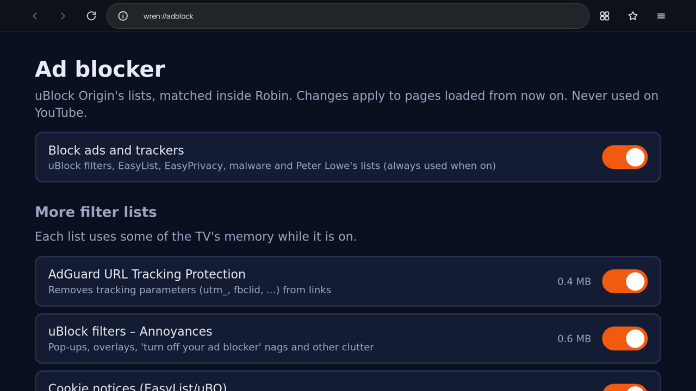

<p align="center">
  
</p>

<h1 align="center">Robin</h1>

<p align="center">
  A web browser for LG webOS TVs, driven with the remote.<br>
  Based on <a href="https://github.com/sostk/webos-wpe-browser">Wren</a> by sostk.
</p>

<p align="center">
  <a href="https://github.com/mihai2mn/robin-webos/releases/latest"></a>
  
  
  <a href="LICENSE"></a>
</p>

<p align="center">
  <a href="#install">Install</a> ·
  <a href="#what-it-does">What it does</a> ·
  <a href="#performance">Performance</a> ·
  <a href="#how-it-was-tested">Testing</a> ·
  <a href="#limits">Limits</a> ·
  <a href="#based-on-wren">Credits</a>
</p>


## Why I made this

My LG CX is in a campervan and runs off a battery. Browsing on a laptop or mini PC next to it would use two to three
times the power of the TV on its own, so I wanted the TV to do the browsing itself.

The TV's built-in browser is years old, and most current sites break or run slowly in it, video sites most of all.
[Wren](https://github.com/sostk/webos-wpe-browser) put a current WebKit on the TV. Robin builds on Wren for the sites
I would otherwise open on a computer: video players, pages of thumbnails with hover previews, long feeds.

## What it does

<table>
  <tr>
    <td width="50%"></td>
    <td width="50%"></td>
  </tr>
  <tr>
    <td valign="top"><b>Browsing.</b> Arrows move a pointer and scroll, OK clicks, Back goes back. Press ▲ at the top of a page for tabs and the address bar.</td>
    <td valign="top"><b>Side panel.</b> Bookmarks, history, zoom per site and settings.</td>
  </tr>
  <tr>
    <td></td>
    <td></td>
  </tr>
  <tr>
    <td valign="top"><b>Ad blocker.</b> uBlock Origin's filter lists, switchable one by one, plus a box for your own rules.</td>
    <td valign="top"><b>Video.</b> Hardware decoding through the TV's own pipeline, full screen, with the remote's media keys.</td>
  </tr>
</table>

For video sites:

- **The TV's hardware decoder plays the main video.** H.264 and VP9 with AAC or PCM audio, full screen, seeking,
  quality changes, and play, pause, rewind and fast-forward from the remote. YouTube plays at full quality
  ([details](docs/video.md)).
- **Hover previews on thumbnail pages play.** Small muted previews are decoded in the page, so they never take the
  decoder away from the video you are watching. At most two play at once, which keeps a page full of them inside the
  memory limit.
- **Seeking and quality switches do not leave a black picture.** Frames are held back until the decoder has a
  keyframe.
- **Busy pages do not freeze the other tabs.** Loading spinners and other endless animations pause while they are
  off screen, and blur effects are drawn by the graphics chip.
- **Memory is capped.** WebKit frees caches as a page grows, and a page that passes 832 MB is reloaded before the TV
  runs out of memory.
- **An ad blocker** built on Brave's adblock-rust with uBlock Origin's lists: network rules, redirects, scriptlets,
  cosmetic and procedural filters, pop-up rules ([details](docs/ad-blocking.md)).
- **Remote control.** Zoom is remembered per site; bookmarks, history and tabs come back after a restart. The TV keyboard
  opens when you click a text field, and typing from LG's phone app works ([usage](docs/usage.md)).

## Performance

The engine is WPE WebKit 2.54.3. WebKit 2.54 switches the JavaScript JIT and its inline caches off on 32-bit builds,
which is what the TV runs. Robin turns them back on, along with the RegExp JIT, and compiles CSS selectors to machine
code ([how](docs/jit-armv7.md)).

Measured on one LG CX (webOS 5.3), same test pages, November 2026:

| | Robin 1.0.0 | Robin 1.1.0 | LG's own browser |
|---|---|---|---|
| Launch to window | 8.4 s | 1.6 s | about 2 s |
| Speedometer 3.1 | 0.505 | 0.61 | cannot run it |
| JavaScript micro benchmark (lower is better) | 858 ms | 415 ms | 358 ms |
| Scrolling a long Wikipedia article | 6 fps | 14 fps | 58 fps |
| Loading that article | 10.7 s | 9.7 s | 4.0 s |

JavaScript now runs close to LG's own browser. Page loads and scrolling are still slower: LG's browser is an older
Chromium that scrolls on the graphics chip, and on the TV's processor WebKit's layout and style work is the main cost.

## How it was tested

Everything below ran on the CX itself, on the 1.1.0 build, except three figures carried over from the testing of
1.0.0: the long playback, the video starts and the news page with four videos.

- **Benchmarks.** The test pages are served by the TV's own web server, so the network does not count. Every run is a
  fresh launch, and Robin, LG's browser and a Chromium port were measured the same way (harness from
  [webos-browser-lab](https://github.com/ViieeS/webos-browser-lab)).
- **JIT correctness.** Checksummed JavaScript kernels, 71 math folding cases, 64 regular expressions each run 300 times,
  and 41 CSS selectors over 366 elements with the selector JIT on and off. The results are identical.
- **Real sites.** 17 sites (news, documentation, shopping, code hosting, forums) for 40 s each with scripted scrolling.
  No page process died. A documentation site that used to crash with the RegExp JIT loaded 8 times out of 8.
- **Long playback.** A 10-minute stream on a real site played to the end, with the web process peaking at 511 MB
  against an 832 MB limit.
- **Video regressions.** Muted test clips on short and long pages, full screen with the side panel open, a seek, and
  leaving full screen. Video starts on a static page: 0 black pictures in 40 starts.
- **Memory.** A news page with four autoplaying background videos uses about 360 MB, against about 700 MB without the
  preview limit. A very large reference page peaks at 351 MB.
- **Review.** Every new engine patch in 1.1.0 had an independent code review; the three problems it found were fixed
  before release.

The release notes have the details for each version: [1.1.0](docs/release-notes-1.1.0.md),
[1.0.0](docs/release-notes-1.0.0.md).

## Install

You need the [Homebrew Channel](https://www.webosbrew.org/), on a rooted TV or on one in Developer Mode. Robin was
tested on a rooted CX; a user reports it running on a non-rooted CX in Developer Mode. Developer Mode has to be
renewed from time to time in LG's Developer Mode app, and apps installed through it stop when it expires. A rooted TV
does not need that.

1. Download `io.github.mihai2mn.robin_1.1.1_arm.ipk` from the
   [latest release](https://github.com/mihai2mn/robin-webos/releases/latest) and check it against `MD5SUMS`.
2. Install it from the Homebrew Channel, or from a PC:

```sh
ares-install -d <your-device> io.github.mihai2mn.robin_1.1.1_arm.ipk
```

The package is about 105 MB to download and 230 MB installed. Have about 400 MB free on the TV's app storage before
you start: an install that runs out of space leaves an app that will not open.

Robin has its own app id, so it installs beside Wren and does not replace it. To bring your Wren bookmarks, history
and filters across, see [Keeping your Wren data](docs/release-notes-1.0.0.md#keeping-your-wren-data).

The release also has `io.github.mihai2mn.robin.dev_1.1.1_arm.ipk`, a second copy that shows as "Robin Test" and keeps
its own data. Most people do not need it.

### Install from the Homebrew Channel by adding this repository

Until Robin is in the Homebrew Channel's default catalog, add this project as an extra repository:

1. Open the Homebrew Channel on the TV and go to **Settings**.
2. Choose **Add repository** (at the bottom of the Repositories list).
3. Enter this address and confirm:

   ```
   https://raw.githubusercontent.com/mihai2mn/robin-webos/main/webos-repo/apps.json
   ```

4. Go back to the app list. Robin appears there. Open it and choose **Install**.

From a PC you can open the same dialog with the address already filled in:

```sh
ares-launch org.webosbrew.hbchannel -d <your-device> -p '{"launchMode":"addRepository","url":"https://raw.githubusercontent.com/mihai2mn/robin-webos/main/webos-repo/apps.json"}'
```

The repository file is [`webos-repo/apps.json`](webos-repo/apps.json). It points at the ipk on the latest release,
with its SHA-256, so the Homebrew Channel checks the download. To remove the repository, select its entry in the same
Settings list.

## Limits

- **One TV model tested.** Other models and webOS versions may work or may not. Reports are welcome.
- **One hardware video at a time.** The TV has one decoder per app. A second video waits until it is the one playing.
- **A paused video that goes full screen stays black until you press play.**
- **Protected (DRM) video was not tested.** Widevine runs at software security level, so services may cap quality
  or refuse. Robin, like Wren, uses the CDM already on the TV, outside the terms it ships under. Use at your own risk.
- **Small muted videos above 720p are not played** until you start them yourself. This keeps pages with many
  background videos inside the memory limit.
- **Very heavy pages**, such as large infinite feeds, can keep one CPU core busy.
- **Cloudflare checks take about a minute** on the TV's processor. Wait for them.

<details>
<summary>More known issues</summary>

- An unmuted video goes to the hardware plane so its sound is heard. That plane does not scroll exactly with the page.
- Full screen for hardware video is emulated: the element is stretched over the screen. An overlay with a very high
  z-index can still cover it ([details](docs/video.md#fullscreen)).
- A video scrolled partly off screen is cropped by the compositor on the tested CX. On older webOS it is shrunk into
  the visible part instead.
- Audio was verified in the player logs, not by a listening test.
- An experimental 64-bit engine exists in the source but is not in the release packages: it draws in software and
  has no hardware video ([details](docs/engine64.md)).
- Video test pages need a server that supports HTTP range requests. `python -m http.server` does not.

</details>

## Reporting a bug

Plug a USB drive into the TV. In Robin, hold OK, then **Settings**, **Help and feedback**, **Save logs to USB**.
Attach the `robin-logs-….txt` file to a report in the [issue tracker](https://github.com/mihai2mn/robin-webos/issues).
Logs are cleared when the TV restarts, so save them first.

Please report Robin's bugs here and not to Wren. Upstream has not seen this code.

## Based on Wren

Robin is a fork of **[Wren](https://github.com/sostk/webos-wpe-browser)** by **sostk**, taken at version 0.3.3.
The browser itself, its remote-first interface, the split between the UI and the engine, the Buildroot-based WebKit
build, the Widevine bridge and most of the media design are upstream's work. Robin keeps Wren's licence and its full
commit history.

Robin is independent. Upstream has not reviewed, endorsed or tested it, and it is not a Wren release. For the
original project, its releases and its list of supported TVs, go to
[upstream](https://github.com/sostk/webos-wpe-browser). The About screen in Robin says "Based on Wren 0.3.3 by sostk".

Some internal names still say Wren (the `wren://` page addresses, file names). They were kept so that nothing breaks.

Robin also uses:

| Project | Used for | Licence |
|---|---|---|
| [WPE WebKit](https://wpewebkit.org/) | The browser engine | LGPL-2.1 and BSD |
| [webos-browser-lab](https://github.com/ViieeS/webos-browser-lab) | The RegExp JIT fixes, the CSS selector JIT and sticky scrolling patches, the benchmark harness | MIT |
| [webOS native app kit](https://github.com/Native-Webos/webos-native-app-kit) | The app shell and packaging | see the kit |
| [adblock-rust](https://github.com/brave/adblock-rust) by Brave | The ad blocker's matching engine | MPL-2.0 |
| [uBlock Origin](https://github.com/gorhill/uBlock) | Filter lists, redirects and scriptlets | GPL-3.0 |
| EasyList, EasyPrivacy, AdGuard and other list authors | Filter lists | each list's own terms |
| [Big Buck Bunny](https://peach.blender.org/), © Blender Foundation | The video frame in the screenshot above | CC BY 3.0 |

Every bundled component, with its source and licence, is listed in [NOTICE.md](NOTICE.md). The icon was generated
with an AI image tool at the maintainer's request and traced to vector; it uses no third-party artwork.

## Documentation

- [Using Robin](docs/usage.md): the remote, launch parameters, logs
- [How it works](docs/architecture.md) and [video](docs/video.md)
- [Building](docs/building.md) and the [patch series](docs/patches.md)
- [Changelog](CHANGELOG.md) and release notes: [1.1.0](docs/release-notes-1.1.0.md), [1.0.0](docs/release-notes-1.0.0.md)
- [Everything else](docs/README.md)

## Contributing

Reports from other TV models help most: use the **Works on my TV** form in the
[issue tracker](https://github.com/mihai2mn/robin-webos/issues/new/choose). For code, see
[CONTRIBUTING.md](CONTRIBUTING.md). Security problems: [SECURITY.md](SECURITY.md).

## Licence

GPL-3.0-or-later, see [LICENSE](LICENSE). Third-party code, fonts, icons and filter lists keep their own licences,
see [NOTICE.md](NOTICE.md). Widevine is not included.
