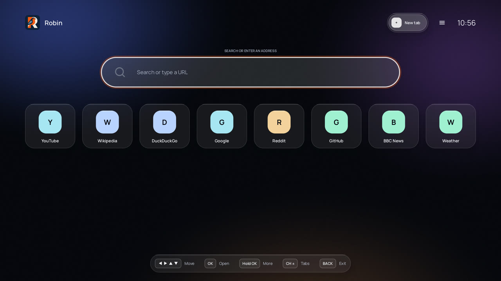

<p align="center"></p>

# Wren (fork): a web browser for LG webOS TVs

This is a fork of **[Wren by sostk](https://github.com/sostk/webos-wpe-browser)** (upstream version 0.3.3). Wren is a
native web browser for LG TVs, made for the sofa: everything works with the arrows, OK and Back of any LG remote.
The browser, its remote-first interface, the Widevine bridge and most of the engine work are upstream's. Please go
to upstream for the original project and its releases. This fork keeps the app name, the app ids and the version
number 0.3.3 of the base it was made from.

| | |
|---|---|
|  **Home**: search, shortcuts, recent pages, open tabs |  **Browsing**: ▲ at the top of a page shows the tabs and the toolbar |
|  **Hold OK**: quick actions and page zoom |  **Menu**: bookmarks, history, zoom, settings |

## What this fork adds over upstream 0.3.3

- **WPE WebKit 2.54.3** instead of 2.50.5, with a patch series for it
  ([patches.md](docs/patches.md)). WebKit 2.54 turned the JIT off on every 32-bit build. The series brings back a
  working **ARMv7 Baseline JIT and DFG** on the TV's 32-bit softfp userland ([jit-armv7.md](docs/jit-armv7.md)).
  The RegExp JIT stays off.
- **A uBlock Origin style ad blocker** (`engine/ubo`) on Brave's adblock-rust: network rules, redirects, scriptlets,
  generic and site cosmetic filters, procedural filters, and a **My filters** box on `wren://adblock`
  ([ad-blocking.md](docs/ad-blocking.md)).
- **An optional 64-bit (aarch64) engine** in the same package. It runs the 64-bit JIT but draws in software and has no
  hardware video ([engine64.md](docs/engine64.md)).
- **Hardware video through LG's Starfish pipeline**: H.264 with AAC audio, other decoded audio (Opus, Vorbis) sent as
  PCM, page volume and mute, a real crop when a video is partly off screen, and seeking. A hybrid policy keeps small
  muted previews in the page and puts the rest on the hardware plane ([video.md](docs/video.md)).
- **Remote media keys** (play/pause, stop, rewind and fast-forward by 10 s) for the page's main video, and **page zoom
  remembered per site** ([usage.md](docs/usage.md)).
- **Memory limits** for the web and network processes, no back/forward page cache by default, and a declared
  memory need in the app's `appinfo.json`.
- **Reproducible release packaging**: `tools/package-release.sh` builds the ipk from a clean clone of a commit
  ([building.md](docs/building.md)).

## Tested hardware

Everything in this fork was tested on one TV: an **LG CX with webOS 5.3** (kernel 4.4.84, about 2.7 GB of RAM).
Other models and webOS versions are untested by this fork. The upstream compatibility notes are in
[compatibility.md](docs/compatibility.md). They describe upstream's testing, not this fork's.

## Install

You need a TV with root access (the Homebrew Channel). The ipk is large: **about 230 MB to download and about 546 MB
installed**, because it carries two engines. The installer needs roughly 380 MB free on the TV's app storage
(see [building.md](docs/building.md#size)). Free space first.

1. Download the ipk from this fork's releases page (TODO(owner): add the link). The files are named
   `org.sostk.wpebrowser_0.3.3_arm.ipk` (the real id) and `org.sostk.wpebrowser.dev_0.3.3_arm.ipk` (a test id that
   installs beside the real app).
2. Install it with the Homebrew Channel's local install or:

```sh
ares-install -d <your-device> org.sostk.wpebrowser_0.3.3_arm.ipk
```

The real id replaces an installed upstream Wren. Remove or keep upstream's copy as you prefer. Use the dev id to try
the fork next to it.

Installing from the Homebrew Channel repository is upstream's route and installs upstream's build, not this fork.

## Using it

The remote, launch parameters and logs are in [usage.md](docs/usage.md). The 32-bit engine is the default. To try the
64-bit engine, launch once with `{"wpebEnv":{"WPE_BROWSER_DEBUG_ENGINE":"64"}}`, or put a file named `engine64`
containing `on` in the app's data folder ([engine64.md](docs/engine64.md)).

## Test tools

`tools/tvdrive/` drives the dev copy of the app from a PC (screenshots, pointer, remote keys, on-screen keyboard), and
reads back what the screen and the page did as text (`frames`: static, moving, flicker; `motion.js`: element motion
from a recorder script). It needs a rooted TV. See [usage.md](docs/usage.md) and [tools/tvdrive/README.md](tools/tvdrive/README.md).

## Reporting a bug

Plug a USB drive into the TV, then in Wren: hold OK, **Settings**, **Help and feedback**, **Save logs to USB**.
Attach the `wren-logs-….txt` file to a bug report at TODO(owner): this fork's issue tracker. Logs are cleared when
the TV restarts, so save them first.

The in-app "Report a problem" row still shows upstream's issue address.

## Limitations and known issues

- **Audio is not confirmed by ear.** Video with AAC or PCM audio was checked in the engine and player logs (the
  volume, mute and PCM calls reach LG's pipeline). Nobody has yet listened to it on the TV.
- **The 64-bit engine is software rendered**, sends shared-memory frames only, and has no hardware video. Cold page
  loads are slower than on the 32-bit engine (Wikipedia: 8.2 s against 4.7 s in the same mode).
- **The package is large.** The ICU data and some libraries are present twice, once per engine.
- **Hybrid video trade-off.** An unmuted video goes to the hardware plane so that its sound is heard. That plane does
  not scroll exactly with the page, and a short clip with sound inside an article also moves there.
- **Only one hardware video at a time** (LG's pipeline).
- **Fullscreen of a hardware video is emulated** (the element is stretched over the screen), because WebKit's own fullscreen
  leaves the video plane behind. Iframe players, trapping containers and gesture rules are handled. An overlay with a high
  z-index can still cover the video. See [video.md](docs/video.md#fullscreen).
- **A video scrolled partly off screen is shrunk, not cropped.** The TV's compositor has no crop request. The picture is
  fitted into the visible part.
- **The RegExp JIT is off on the 32-bit engine.** With it on, the web process of one tested site crashed shortly
  after load. The Baseline JIT and DFG are on. A page load was not faster with the JIT in the tests. See
  [jit-armv7.md](docs/jit-armv7.md).
- **Widevine runs at software security level**, so some services cap the quality or refuse to play. This fork did not
  test DRM. Upstream lists no DRM for webOS 5 (the TV's Widevine interface there is version 15.1,
  which Wren does not use).
- Wren uses the TV's own provisioned Widevine CDM. This is outside the terms LG and Google ship it under, and the
  TV's Widevine certificate could in principle be revoked. **Use at your own risk.**
- Cloudflare security checks ("Verifying you are human") take about a minute on a TV's processor. Wait for
  them; the site then remembers the pass for a while.
- Test pages for video must come from a server that supports HTTP range requests. A plain `python -m http.server`
  does not, and the engine then reports "unexpected 200 status".

## More

[Documentation](docs/README.md): using the remote, launch parameters and logs, how it works, building, patches.
The development log is [NOTES.md](NOTES.md). It is upstream's log and also holds this fork's early notes.

## Licence

GPL-3.0-or-later ([LICENSE](LICENSE)). Fonts: Manrope and Atkinson Hyperlegible (SIL OFL). Bundled libraries keep
their own licences ([details](docs/building.md#licences-in-the-package)). The ad blocker uses adblock-rust (MPL-2.0)
and a copy of rustc-hash (MIT or Apache-2.0, `engine/ubo/vendor`). The filter lists keep their own licences
(`tools/ubo/update.py` names them). Widevine is not included: Wren uses the CDM already on the TV. Built with the
[webOS native app kit](https://github.com/Native-Webos/webos-native-app-kit). Upstream: [sostk/webos-wpe-browser](https://github.com/sostk/webos-wpe-browser).
